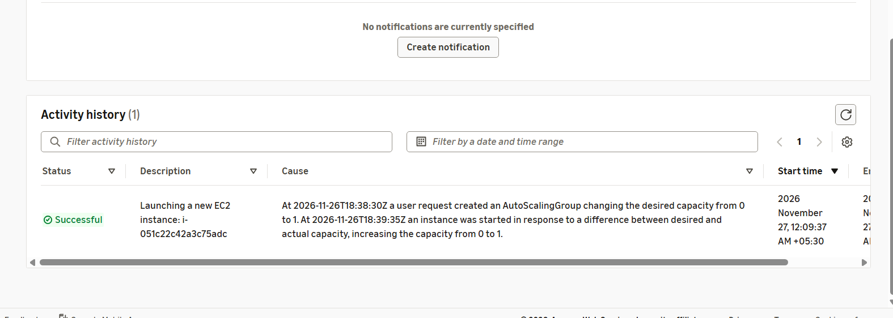
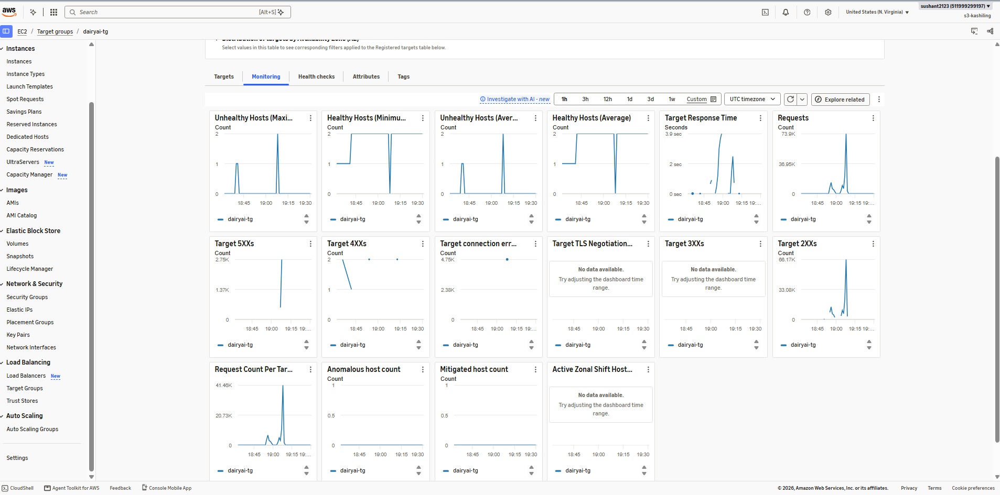
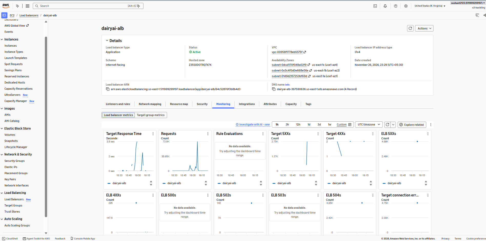
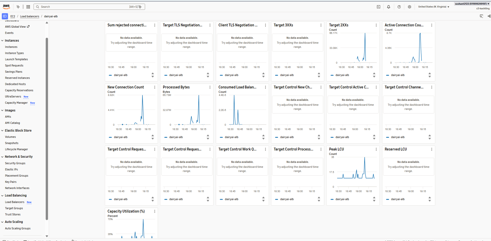
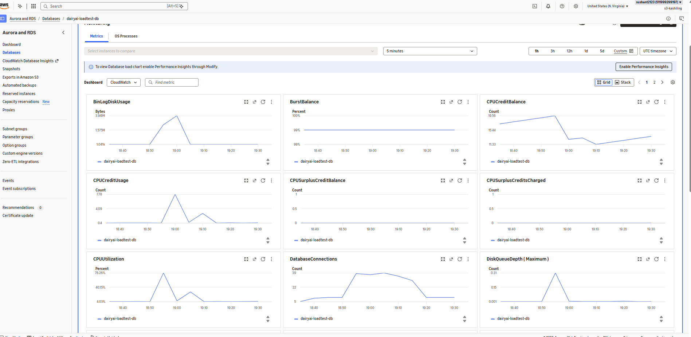
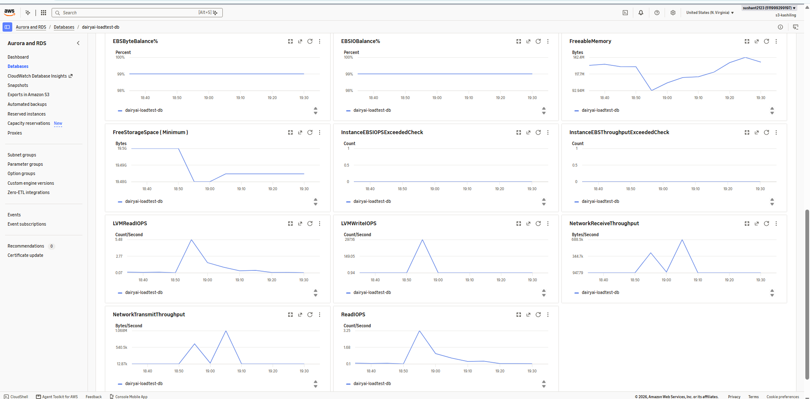

# DairyAI Nexus — AWS Scaling & Apache JMeter Load Test Reports

**Test Environment (`us-east-1`):**
- **Load Balancer:** AWS Application Load Balancer (`dairyai-alb`) across 3 AZs (`us-east-1a`, `us-east-1b`, `us-east-1c`)
- **App Tier:** Auto Scaling Group (`t3.small`, `Min 1 / Max 3`, CPU 50% target) running NGINX (`worker_connections 8192`) + Spring Boot 3.3.5
- **Database & Cache:** AWS RDS MySQL 8.4 (`db.t4g.micro`) + Redis (`@Cacheable` on `rateCharts`)
- **Load Generator:** Dedicated `m7i-flex.large` EC2 running Apache JMeter 5.6.3 CLI

---

## Raw Apache JMeter HTML Dashboard Reports

| Test | Scenario | Total Requests | Avg Latency | Throughput | Error Rate | Raw Report |
| :--- | :--- | :--- | :--- | :--- | :--- | :--- |
| **Test 1** | **Mixed Read/Write** (`300` users, `60s` ramp-up: `3 GET` + `1 POST /api/milk-collections`) | **34,492** | 1,848.9 ms *(Min 6 ms)* | 140.2 req/s | **0.00%** | [Open Report 1](performance/report1/index.html) |
| **Test 2** | **Staged 5,000 Users** (`120s` ramp-up, `4` loops on Redis-cached `GET /api/pricing-settings`) | **20,000** | **10 ms** *(Min 5 ms)* | 166.6 req/s | **0.00%** | [Open Report 2](performance/report2/index.html) |
| **Test 3** | **Extreme 15s Burst** (`5,000` users, `4,985` active simultaneously, `20` loops) | **100,000** | 2,681 ms *(Min 1 ms)* | **1,207.5 req/s** *(1,395.2 peak)* | 8.27% *(cold-start lag)* | [Open Report 3](performance/report3/index.html) |

- **JMeter Test Plans:** [test1_mixed.jmx](performance/test1_mixed.jmx) | [test2_5000.jmx](performance/test2_5000.jmx)

---

## AWS CloudWatch & Auto Scaling Proof

### 1. Auto Scaling Group Activity (`dairyai-asg`)

### 2. Target Group Monitoring (`dairyai-tg` — `Healthy Hosts 1 -> 2`, `73.9K Requests`)

### 3. Application Load Balancer (`dairyai-alb`)

### 4. AWS RDS MySQL (`dairyai-loadtest-db`)

